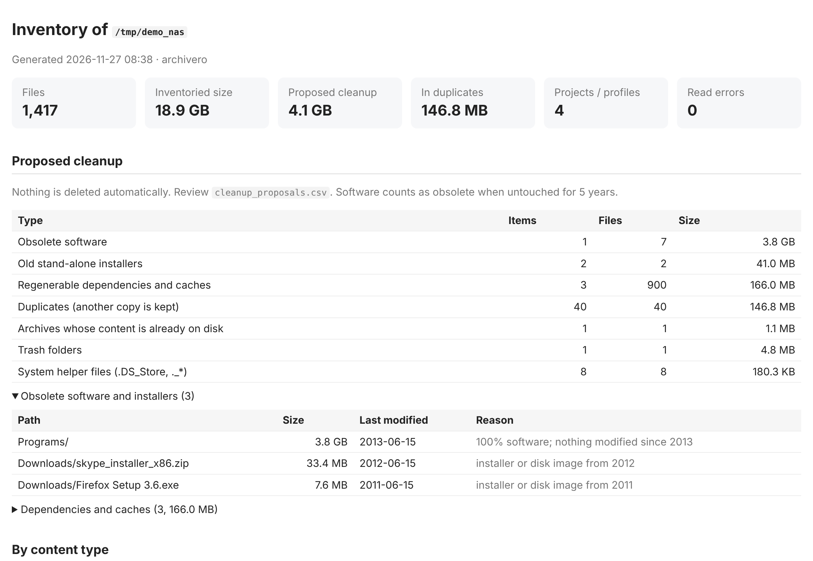
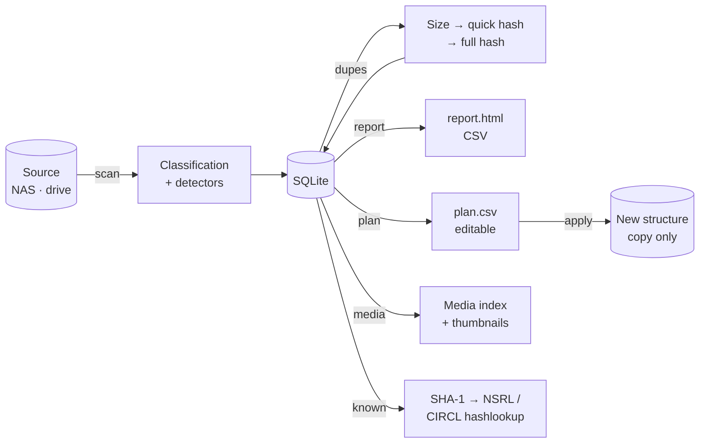

<p align="center">
  
</p>

<p align="center">
  
  
  
  
  
</p>

<p align="center">
  <b>That old NAS. That backup drive. That "Misc" folder with fifteen years of history.</b><br>
  archivero walks through it, works out what each folder is, finds what is duplicated or obsolete,<br>
  and proposes how to reorganize it by type and date. <b>You decide. It never deletes anything.</b>
</p>

<p align="center"><sub><i>archivero</i> /ar.tʃiˈβe.ɾo/ is Spanish for <i>archivist</i> and, in Mexico, for a
<i>filing cabinet</i>.</sub></p>

---

## ✨ What it finds

| | |
|---|---|
| 📸 **Photos and videos** | The real date of every photo (EXIF, the file name or the modification date). Tells home videos apart from movies. A **media index** with metadata, thumbnails and perceptual hashes for [memento](https://github.com/isaacagudo/memento) |
| 🎵 **Music** | Album folders and, if you want, artist and album from the ID3 tags |
| 📄 **Documents** | PDFs, Word files, spreadsheets and slides, grouped by year |
| 🧑‍💻 **Code projects** | Recognized as a whole (`package.json`, `.git`, `pom.xml`…), without getting lost in `node_modules` |
| ✉️ **Email** | Thunderbird profiles and their **mbox** files, even without an extension, plus loose PST and EML files |
| 🗜️ **Old software** | Folders of installers, ISOs and `.app` bundles that nobody has touched in years |
| 🖥️ **Old computers** | Recognizes copied Windows, macOS and Linux drives and profiles, **even partial copies**, keeps personal files apart from system files, and says where they came from: *"Windows XP Service Pack 3, probably a Dell laptop (Latitude D630), personal files from 2006–2008"*. The exact version comes from the drive itself (registry, `SystemVersion.plist`, `os-release`) when it is there |
| 🔎 **Known software** | Recognizes OS and program files **by content**, even copied out of place, with the public NSRL and CIRCL hashlookup sets, **offline** |
| 🗃️ **Archives and disk images** | Looks inside zip, tar, 7z, rar, ISO, DMG, VMDK… **without extracting them**, and tells you whether a backup zip is already extracted somewhere else |
| 👯 **Duplicates** | Confirmed by content in two passes, with a sensible rule for which copy to keep |
| 🧹 **Junk** | `.DS_Store`, `Thumbs.db`, network trash folders, caches and regenerable dependencies |

## 🖼️ What it looks like

<p align="center">
  
</p>

Besides the HTML report, everything is exported to **CSV**, ready for a spreadsheet.

## 🚀 Quick start

```bash
git clone https://github.com/isaacagudo/archivero.git
cd archivero
pip install .                 # or: pipx install .   (extras: pip install ".[all]")

archivero scan   /path/to/nas --db nas.db --archives   # 1. walk and classify (+ archive indexes)
archivero dupes  --db nas.db                             # 2. confirm duplicates by hash
archivero report --db nas.db --out report                # 3. HTML report + CSV
open report/report.html
```

### Archives and disk images, without extracting

```bash
archivero archives list    --db nas.db               # read indexes only: names, sizes, dates, CRC32
archivero archives inspect --db nas.db --suggested   # hash members in memory, only where it pays off
```

`list` is cheap: it reads the zip central directory, the 7z header or the ISO
directory, never the data. From that alone archivero tells you, for each archive:

- **Already extracted.** Its files are already in a folder on disk (it even notices
  when that folder was renamed).
- **Worth inspecting.** It holds photos, documents or mail that exist nowhere else.
- **Software or OS image.** Installers and system files.

`inspect` streams every member through a hash in memory, with no temporary files.
That confirms or rules out the matches: an archive is only proposed for cleanup when
**every file is confirmed by hash** to exist on disk.

| Formats | Backend |
|---|---|
| zip, tar, tar.gz/bz2/xz | Python standard library (built in) |
| 7z, rar, cab, iso, xar, cpio | [`libarchive-c`](https://pypi.org/project/libarchive-c/) (`pip install ".[archives]"`) or 7-Zip |
| dmg, vmdk, vhd/vhdx, vdi, qcow2, wim, img | [7-Zip](https://www.7-zip.org/) command line (`brew install sevenzip`, `apt install 7zip`) |

### Photo and video index

```bash
pip install ".[photos]"                   # Pillow; ".[heif]" adds HEIC, ffmpeg adds videos
archivero media --db nas.db               # or: archivero scan … --media
archivero media --db nas.db --archives    # also pictures inside listed archives and disk images
```

`media` reads every photo **once** and keeps, for each unique picture (identical copies count
once): capture date and time zone offset, GPS, camera, lens, size, orientation, video duration
and codecs, a **320 px WebP thumbnail** (in `nas.db.media/`, next to the database) and a
**perceptual hash** to find resized copies. Icons, wallpapers, sample pictures and cached web
images are **flagged, not removed**. It is resumable, like everything else, and it is what
[memento](https://github.com/isaacagudo/memento) builds its timeline from. Details in
[`docs/ARCHITECTURE.md`](docs/ARCHITECTURE.md#media-index-media_indexpy).

### Known OS and software files

```bash
curl -O https://cra.circl.lu/hashlookup/hashlookup-full.bloom   # once, about 1 GB
archivero known --db nas.db --bloom hashlookup-full.bloom          # and/or --nsrl RDS_modern_minimal.db
```

`known` computes the SHA-1 of the files that could be software (programs, libraries,
installers, and other non-personal files outside user folders; never documents, photos
or mail) and looks them up in public sets of files shipped by operating systems and
software vendors. The CIRCL Bloom filter and NIST's NSRL RDSv3 databases are checked
**on your machine**; nothing is sent anywhere unless you add `--online`, and then only
the SHA-1 of executables the offline sets do not know. Known files become cleanup
proposals even when they were copied out of place (an old `Program Files` inside
`Backup/old`, a loose installer), and executables in system folders that no set knows
are listed for review. Hashing is done once and resumable, so a new set can be checked
later without reading the files again.

Happy with the proposal? Generate a plan and apply it **by copying** into a new
structure:

```bash
archivero plan  --db nas.db --dest /Volumes/New --out plan.csv   # editable CSV
archivero apply --plan plan.csv                                   # dry run
archivero apply --plan plan.csv --execute                         # real copy
```

Want to try it without touching your data? `python3 scripts/demo_tree.py /tmp/demo`
builds a sample tree that looks like 21 GB but uses under 300 MB of disk. With Pillow
(and ffmpeg) its photos and clips are real, so `archivero media` has something to index.

## 🧭 How it works



- **Resumable.** If it stops after three hours, run the same command again and it
  continues where it was.
- **Fast where it matters.** It only reads file contents when needed: hashes only for
  duplicate candidates, and EXIF, ID3 tags or video duration only if you ask.
- **Repeatable.** Reports and plans are built from the database in seconds, so you
  can try other thresholds without scanning again.

## 🛡️ Safety promise

- No command **deletes or moves** anything in the source.
- Cleanup is a **proposal** (`cleanup_proposals.csv`), with the reason for every item
  and an `approve` column for you to fill in.
- For every group of duplicates it states **which copy is kept and why**: the one
  inside a project, the one that does not look like a backup, the oldest.
- `apply` only copies, and never overwrites what is already there.

## 📦 What `report` produces

| File | Use it to |
|---|---|
| `report.html` | Browse a summary: cleanup, types, years, email, music, folders, duplicates |
| `cleanup_proposals.csv` | See what could go, how much space it frees, and why |
| `folders.csv` | Get every folder with its type ("Photos and videos", "Software", "Code project"…), size and dates |
| `files.csv` | Get one row per file: category, zone, date, where the date came from, hash, and whether a known-file set knows it |
| `duplicates.csv` | Review groups of identical copies, with the one to keep marked |
| `units.csv` | List code projects and mail profiles, with their mailboxes |
| `sources.csv` | See every copied drive or profile, what it looks like, its exact OS version when known, and the evidence behind it |
| `containers.csv` | Review every archive and disk image: content, how much is already on disk, suggestion |
| `archive_members.csv` | Browse the files inside archives without opening them |

## ⚙️ Configuration

```toml
# archivero.toml  →  archivero report --config archivero.toml ...
[archivero]
obsolete_years = 6       # years untouched before software counts as obsolete
software_share = 0.8     # minimum share of software in a folder
long_video_min = 40      # minutes before a video counts as a movie (with --probe-video)
known_bloom = "/data/hashlookup-full.bloom"   # default set for 'archivero known'

[categories]
code = ["cairo", "move"]
```

Optional extras: `pillow` (EXIF dates, `--exif`, and the media index), `pillow-heif`
(HEIC photos in the media index), `mutagen` (audio tags, `--tags`), `libarchive-c` and
7-Zip (more archive and disk image formats) and ffmpeg (video duration with
`--probe-video`; video metadata and thumbnails in the media index).

## 🔌 Extensible

Every rule that gives a folder its meaning is a **detector**: a small function that
looks at the names in a folder and says what it is. A new one, for Lightroom
catalogs, WhatsApp backups or virtual machines, takes a few lines. See
[`docs/ARCHITECTURE.md`](docs/ARCHITECTURE.md).

## 🗺️ Roadmap

- **v0.2. Personal data vs. system files** (in progress): OS layouts, zones,
  provenance, exact OS versions, the known-file filter (NSRL and CIRCL hashlookup) and
  the media index are done; left are `Windows.old`, Photos libraries and iCloud Drive
  as special cases, and the known-file filter for archive members
  ([design](docs/OS_LAYOUTS.md)).
- **v0.3. Email, inside the mailboxes:** messages, senders and dates for every mbox,
  and messages duplicated across profiles.
- **v0.4:** whole duplicated folders (Merkle hash) and near-identical photos.
- **v0.5:** quarantine with `undo`, and hash verification when copying.
- **v0.6–0.7:** parallel scanning, tens of millions of files, interactive report,
  PyPI release.

Full details in [`docs/ROADMAP.md`](docs/ROADMAP.md).

## 💡 Tips

- **NAS over NFS:** NFS v3 grants access by numeric UID. If your local user does not
  match the NAS user, [`docs/NAS_NFS.md`](docs/NAS_NFS.md) shows how to handle it on
  Linux and macOS.
- Run archivero as close to the data as you can: wired beats Wi-Fi, and NFS or SMB
  beat SSH.

## 🤝 Contributing

Ideas, new detectors and bug reports are welcome. Before opening a PR:

```bash
pip install ".[dev]"
python -m pytest
```

## 📄 License

[MIT](LICENSE) © Isaac Agudo
